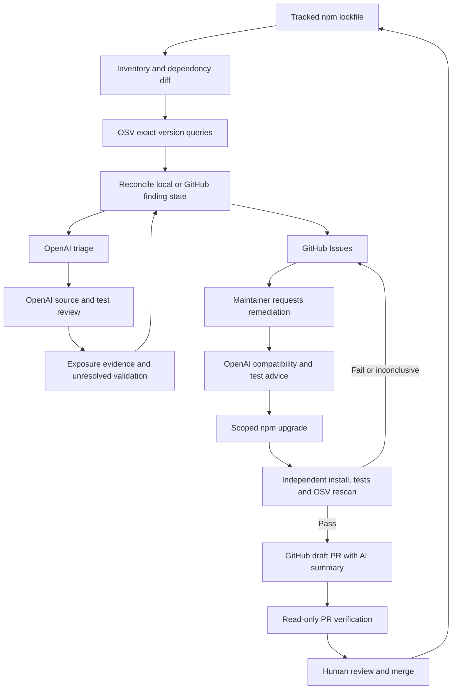

# Dependency AppSec

This service inventories one npm lockfile, matches public npm versions against OSV, and reconciles the resulting findings into GitHub Issues. Maintainers can request a dependency-only draft PR for a current finding. A draft requires a fresh OSV check, a successful installation, and passing compatibility tests. Merge approval belongs to maintainers and repository branch protection.



## Setup

Use Python 3.12 and Git. Remediation also uses a running Docker daemon and a Node 24 container.

```bash
python3 -m venv /tmp/juice-appsec
source /tmp/juice-appsec/bin/activate
pip install ./appsec
appsec --help
```

Choose the lockfile in [example.toml](example.toml). The workflows target the root lockfile. To switch their scope, update the config and the paths used by the PR scan. Juice Shop ignores npm lockfiles and sets `package-lock=false` in its root npm configuration. This fork force-tracks a root `package-lock.json` (npm v3) so the workflows have an exact dependency graph; the AppSec commands pass `--package-lock=true` explicitly.

```bash
npm install --package-lock-only --package-lock=true --ignore-scripts --no-audit --no-fund
git add -f package-lock.json
```

Optional committed baseline artifacts can be created with `appsec inventory --inventory-out appsec/inventory-baseline.json`. Generate a workflow baseline with `GITHUB_REPOSITORY` set to the target owner and repository, or set the repository in the config. Scheduled runs prefer the inventory artifact from the most recent successful run and use the tracked baseline as a fallback. The SQLite database stores transitions, normalized advisory data, decisions, evidence, and execution metadata. GitHub Issues preserve identity and lifecycle across ephemeral runners. Keep the inventory, SQLite artifacts, and issue visibility appropriate for your repository's source and security data.

For OpenAI, provide a project key in `OPENAI_API_KEY`. Set the model, request budget, and estimated per-million-token rates in the TOML file. Requests have bounded excerpts and output, a timeout, and no callable tools. A missing key still permits deterministic inventory, scanning, issue creation, and maintainer-requested dependency remediation. Failed or deferred assessments can be retried during reconciliation.

Local operations use dry-run mode by default. Use `--apply` with a clean checkout of the GitHub default revision and a repo-scoped `GITHUB_TOKEN` to enable writes. A scan token needs no GitHub write access. Reconciliation needs issues write access. Draft creation also needs contents and pull requests write access. If using a dedicated GitHub identity for issue creation, set `APPSEC_GITHUB_ACTOR` to that identity consistently across all writers. Keep credentials in environment variables or GitHub secrets.

## Local commands

```bash
appsec inventory --inventory-out inventory.json
appsec scan --base-ref HEAD~1 --ref HEAD
appsec reconcile --config appsec/example.toml
appsec triage --config appsec/example.toml
appsec hunt --finding-id FINDING_ID
appsec validate --finding-id FINDING_ID
appsec remediate --config appsec/example.toml --finding-id FINDING_ID --dry-run
appsec report
```

Use a consistent config and database across commands. The `--ref` option inventories the committed lockfile. Local inventory comparison also accepts `--base-inventory`.

Set `test_commands` and `rebuild_packages` in the config to choose the checks that run offline after installation. Before enabling `run_npm_tests`, review the trusted checkout's test scripts and confirm it can run after an install with lifecycle hooks disabled and with the test container's network disabled. Some projects, including Juice Shop, require project-specific build steps before their full suite can run under those constraints. The supplied fixture works with the standard runner. Unverified upgrades escalate to human review.

## GitHub Actions

Set `OPENAI_API_KEY` as an Actions secret, enable GitHub Actions to create pull requests, and configure required reviewers on the `appsec-remediation` environment. Protect the default branch with review and required checks.

| Workflow | Trigger and result |
| --- | --- |
| AppSec PR scan | Relevant PR updates. The base revision supplies scanner code. The candidate supplies the lockfile as Git data. The job has read access and publishes counts and artifacts. |
| AppSec reconciliation and remediation | A push to the default branch that changes `package.json` or `package-lock.json`, daily at 05:17 UTC, or manual dispatch. Matches dependencies, synchronizes issues, then runs one parallel remediation job per finding. Each job opens a draft PR only after the OSV rescan, install, sqlite3 rebuild, server unit tests and TypeScript compile check pass, and then dispatches independent PR validation. |
| AppSec manual remediation | Dispatch from the default branch with the issue's finding ID. Tries a bounded set of same-major fixes. Creates or reuses a draft only after verification passes. |
| AppSec remediation validation | Runs on eligible PR events or by dispatch with the PR number. Requires a same-repository AppSec branch and tests the candidate manifests against trusted base code. |

PRs created with the built-in Actions token may require manual dispatch of the validation workflow. Human risk acceptance is recorded by explicitly applying the `risk-accepted` label and documenting the reason on the issue. Reconciliation uses a successful scan and exact-version absence before marking a finding fixed. Issues remain available for audit and rediscovery.

## Decision boundaries

- Lockfile parsing, OSV facts, identity, GitHub mutations, retries, file allowlists, npm edits, and fix verification are deterministic. Private, ambiguous, linked, and unsupported dependencies appear as coverage gaps.
- OpenAI recommends priority and disposition, finds additional source and test references, assesses upgrade compatibility, proposes benign compatibility behavior to cover, and drafts the PR explanation. The service checks the response schema and cited evidence IDs.
- Exposure validation records whether existing tests were identified and whether the evidence supports further human review. Its automated result is `unable to validate` when a behavioral finding requires reproduction.
- Dependency and compatibility checks gate draft creation. Test proposals are advisory. Automated fixes are restricted to the selected manifest and lockfile.

## Offline demonstration

```bash
python -m unittest discover -s appsec/tests -v
```

The fixture starts with `minimist@1.2.5` at `node_modules/minimist`. It models `GHSA-xvch-5gv4-984h` and upgrades to `1.2.6`. The pipeline records `needs-validation`, synchronizes GitHub issue #1, verifies the scoped upgrade, opens draft PR #2, and marks the original issue `fixed` after a simulated merge and rescan. The test resets local state between runs to check that the same issue, commit, and draft PR are reused. HTTP responses and Docker calls are substituted in the offline tests. The npm package and advisory identifiers are real. [GitHub advisory](https://github.com/advisories/GHSA-xvch-5gv4-984h)

## Checking a reconciliation run

Open the Summary tab of the GitHub run for stage results, a remediation table, and expandable finding decisions with source citations. The same readable report is saved as `review/REPORT.md`. Download the reconciliation artifact, extract it, and open `review/README.md`. Each finding links its installed paths to advisory facts, lifecycle transitions and numbered OpenAI calls. Each call includes its supplied source excerpts, accepted output, and citation check. Skipped requests carry their reason in the finding record. The OSV exchanges appear in request order in `review/osv.jsonl`.

To export a previous single-run reconciliation artifact, run `python -m appsec.review --db appsec.sqlite --mode dry-run --out review` in the extracted directory. Use `--mode apply` for a run that synchronized GitHub issues. Earlier databases can lack raw OSV exchanges and rejected call inputs.

### How triage assesses local risk

OSV establishes the affected version. Triage also receives the advisory description, installed dependency types and parents, and bounded repository excerpts. The collector labels manifest entries, build configuration, project imports, possible calls to imported names, tests, and plain text mentions. The queue prioritizes findings with evidence of project use within the request budget.

Each assessment records advisory prerequisites, static reachability, input exposure, controls, possible impact, local priority, and missing evidence. Confirmation requires citations for all three exposure observations, a candidate call in the reviewed project, and a directly observed input source at a call. The current input-source check recognizes a small set of Node request and CLI argument expressions. An intermediate buffer or wrapper can leave provenance unresolved. The scanner uses lexical matching and lockfile metadata. Dynamic loading, actual deployment configuration, transitive execution and runtime input provenance can require maintainer verification. Local priority is a review recommendation. Risk acceptance remains a human decision.
